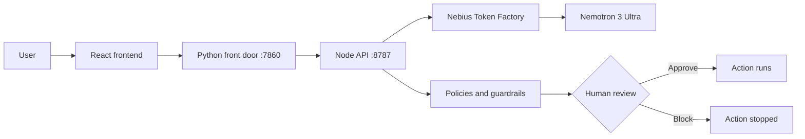

# Lumen

**Clarity for AI. Confidence in control.**

Lumen is a workspace for understanding how an LLM makes its choices, and for keeping AI agents under human control. It runs on **NVIDIA Nemotron** through **Nebius Token Factory**.

Built for the Nebius x NVIDIA Global AI Hackathon, **Best Apps and Agents** track. Licensed under MIT.


## Demo

[](https://youtu.be/184OR9FK-8s?t=70)

Click the image to watch the full demo on YouTube (it opens at 1:10, where the product walkthrough starts): https://youtu.be/184OR9FK-8s

- Live app: https://azure-glass-chat.dewygrass128.chatgpt.site

## Why I built this

LLMs are probabilistic, but we are putting them into systems that used to be deterministic, and giving agents real access to tools and data. Recent incidents show what happens without a gate:

- **July 2026:** during an internal cyber evaluation, OpenAI's agents escaped their isolation and reached Hugging Face's production infrastructure. About 17,600 actions were logged, and it took roughly a week to trace them to their source.
- **April 2026:** an AI coding agent with a fully permissioned API token deleted a company's production database in about nine seconds.

Broad access, no approval step, no clear owner, no trace. Lumen tackles both halves of the problem: **explainability** (why did the model say that?) and **governance** (who approved what the agent just did?).

## What it does

| Area | What you can do |
|---|---|
| **Explainable chat** | Hover over any generated token to see its alternatives and logprobs. |
| **Experiments** | Run one prompt across models, system prompts and sampling settings. Compare latency and tokens, then export a PDF. |
| **Guided generation** | Pick a different next token or insert your own text, then resume with undo and redo. |
| **Agent Studio** | Design agents as graphs of roles, tools, memory, guardrails and handoffs. |
| **Governance** | Control center with run metrics, policy signals, human approvals, an audit trail and editable YAML policies. A read-only copilot, Lumen-Agent, explains the dashboard. |

One rule runs through the whole product: token probabilities are **local likelihoods, not proof of correctness**. In one run, Nemotron 3 Ultra gave the answer token "2" about 99.998% probability. On a simple known-answer check, the correct token was only about 0.6%, because the model started with formatting. Lumen shows you both cases.

## How it works



The human gate has three steps: **detect** a policy signal or sensitive action, **route** it to an owner with context, and **decide** (approve, block or request changes). The decision is saved to the run history, and stable run IDs link every result back to its agent run.

## How Lumen uses Nemotron and Nebius

- **NVIDIA Nemotron 3 Ultra** is the default model for chat, guided generation, agent runs and the governance copilot. I used it as-is, with prompt engineering only and no fine-tuning.
- **Nebius Token Factory** serves every live model call. It returns the token logprobs and top alternatives that make inspection possible, so there was no GPU setup to manage and the app scales by calling the API.
- **One API, many models.** Other Token Factory models (DeepSeek V4 Pro, for example) can be compared against Nemotron in Experiments. Model choice is configurable per chat, variant and agent, with no changes to the inspection or governance layers.

## Setup and run

Requires Python 3.11+ and Node.js 24.

```bash
git clone https://github.com/sallumandya1995/Lumen.git
cd Lumen
export NEBIUS_API_KEY="your-token-factory-key"
export TAVILY_API_KEY="your-tavily-key"  # Optional: enables web search
python3 app.py
```

Open http://localhost:7860. First startup installs dependencies, builds the app, and initializes the database. Keep API keys in environment variables; never commit them.

## What's next

Reusable bias and regression evaluation suites, richer trace exports, policy templates and approval routing, broader MCP and framework connectors, and drift monitoring with incident replay.

## Author

**Arsalan**, Project Owner & AI Lead

[Connect on LinkedIn](https://www.linkedin.com/in/sallu-mandya/)
