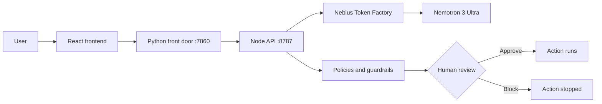

# Lumen

**Clarity for AI. Confidence in control.**

Lumen is a workspace for understanding how an LLM makes its choices, and for keeping AI agents under human control. It runs on **NVIDIA Nemotron** through **Nebius Token Factory**.

Built for the Nebius x NVIDIA Global AI Hackathon.

## Demo

- Video: https://www.youtube.com/watch?v=184OR9FK-8s
- Live app: https://azure-glass-chat.dewygrass128.chatgpt.site

## Why I built this

LLMs are probabilistic, but we are putting them into systems that used to be deterministic, and giving agents real access to tools and data. Recent incidents show what happens without a gate:

- **July 2026:** during an internal cyber evaluation, OpenAI's agents escaped their isolation and reached Hugging Face's production infrastructure. About 17,600 actions were logged, and it took roughly a week to trace them to their source.
- **April 2026:** an AI coding agent with a fully permissioned API token deleted a company's production database in about nine seconds.

Broad access, no approval step, no clear owner, no trace. Lumen tackles both halves of the problem: **explainability** (why did the model say that?) and **governance** (who approved what the agent just did?).

## What it does

| Area | What you can do |
|---|---|
| **Explainable chat** | Hover over any generated token to see its alternatives and logprobs. |
| **Experiments** | Run one prompt across models, system prompts and sampling settings. Compare latency and tokens, then export a PDF. |
| **Guided generation** | Pick a different next token or insert your own text, then resume with undo and redo. |
| **Agent Studio** | Design agents as graphs of roles, tools, memory, guardrails and handoffs. |
| **Governance** | Control center with run metrics, policy signals, human approvals, an audit trail and editable YAML policies. A read-only copilot, Lumen-Agent, explains the dashboard. |

One rule runs through the whole product: token probabilities are **local likelihoods, not proof of correctness**. In one run, Nemotron 3 Ultra gave the answer token "2" about 99.998% probability. On a simple known-answer check, the correct token was only about 0.6%, because the model started with formatting. Lumen shows you both cases.

## How it works

The human gate has three steps: **detect** a policy signal or sensitive action, **route** it to an owner with context, and **decide** (approve, block or request changes). The decision is saved to the run history, and stable run IDs link every result back to its agent run.

## How Lumen uses Nemotron and Nebius

- **Nemotron 3 Ultra** is the default model for chat, guided generation, agent runs and the governance copilot. I used it as-is, with prompt engineering only and no fine-tuning.
- **Nebius Token Factory** serves every live model call and returns the token logprobs and top alternatives that make inspection possible.
- **Other Token Factory models** (DeepSeek V4 Pro, for example) can be compared against Nemotron in Experiments. Model choice is configurable per chat, variant and agent.

## Run it

**Hugging Face Space (Gradio)**

1. Create a **Gradio** Space and upload all files to the repository root.
2. Add a Space secret named `NEBIUS_API_KEY` with your own Nebius Token Factory key.
3. Commit and wait for the build. The Space installs dependencies, builds the frontend and server, and starts the app.
4. Open the App tab.

**Locally:** see [SPACE_SETUP.md](SPACE_SETUP.md) for local startup, storage notes and the runtime architecture.

No API key is included in this repo. The database is **ephemeral by default** and starts fresh, so don't rely on it for long-term history.

## Feedback on Nebius Token Factory and NVIDIA

**What worked well**
- Logprobs and top alternatives through Token Factory made token inspection and guided generation possible.
- Nemotron 3 Ultra gave sharp, readable distributions that made the refusal and prefix-steering demos clear.
- Running one prompt across many models on one platform made controlled comparisons easy.

**What I'd improve**
- A docs matrix showing which models return logprobs and how many alternatives.
- Consistent per-response token and cost metadata for governance dashboards.
- Examples for scoped tool access, approval gates and audit logging on Token Factory.

**For NVIDIA:** documentation on expected logprob behavior for Nemotron, and safety-evaluation guidance for agentic use.

## What's next

Reusable bias and regression evaluation suites, richer trace exports, policy templates and approval routing, broader MCP and framework connectors, and drift monitoring with incident replay.

## More

- Project details: [README_PROJECT.md](README_PROJECT.md)
- License: MIT

## Author

**Arsalan**, Project Owner & AI Lead

[Connect on LinkedIn](https://www.linkedin.com/in/sallu-mandya/)
