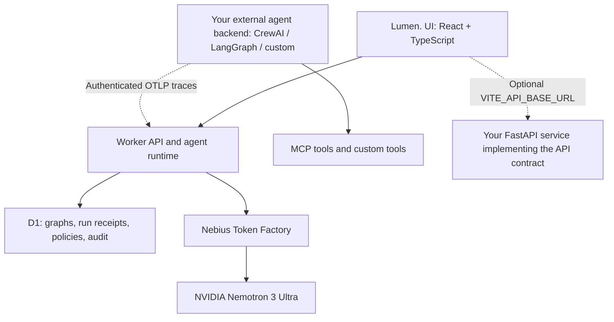

# Lumen.

**Clarity for AI. Confidence in control.**


Built by [Arsalan](https://www.linkedin.com/in/sallu-mandya/) for the **Nebius × NVIDIA Global AI Hackathon**. Lumen combines explainable chat, guided generation, prompt/model experiments, agent design, and governance.

**Demo:** https://azure-glass-chat.dewygrass128.chatgpt.site/
**Architecture page:** https://azure-glass-chat.dewygrass128.chatgpt.site/#architecture

## Features

- **Explainable Chat:** inspect generated-token probabilities and ranked alternatives, copy/edit prompts, compare conversations, and paste images for vision-derived context.
- **Guided Generation:** choose next tokens, insert tokens or sentences to steer the LLM, undo/revert, or Play the highest-probability usable continuation. Narrow screens show three rows of horizontally scrollable choices.
- **Experiments:** compare temperatures, Top P, system prompts, and selected models; inspect token differences, usage, observed duration, and manually priced estimates. Export PDF.
- **Agent Studio:** edit agents, nodes, edges, tool bindings, prompts, memory, policies, and runtime settings. Test a node or run a saved graph. Saved configurations are shared with Governance.
- **Governance:** server-recorded runs, tool receipts, policy events, reviews, signed evidence, and optional authenticated external traces. Live activity is the default. Seeded/sample records and unverified browser imports are marked **Historical data** and excluded from live metrics.

NVIDIA `nvidia/Nemotron-3-Ultra-550b-a55b` is the default for new chats, guided sessions, and experiment variants. Other supported models remain selectable. An active restored guided draft keeps its original model so continuation stays consistent.

## Architecture



The hosted app uses React 19, TypeScript, Vinext/Vite, Cloudflare Workers, and D1. Model credentials stay on the server. Built-in Studio tools are local TypeScript functions. External MCP tools execute in your backend; saving a connector URL alone does not connect a tool. See `examples/lumen-connectors/` for Python adapters and `examples/governance-backend/` for the optional FastAPI example. The latter is a separate integration starting point, not the deployed backend.

## Setup

Prerequisites: Node.js 24 recommended (at least 22.18), pnpm, and a Nebius Token Factory API key with access to the selected model. Use the repository lockfile.

```bash
corepack enable
pnpm install --frozen-lockfile
cp .env.example .dev.vars
```

Edit the ignored `.dev.vars` file and replace the placeholder:

```dotenv
NEBIUS_API_KEY=your_token_factory_api_key
```

Never put the key in a `VITE_` variable, browser code, a screenshot, or a committed file. The default model uses `https://api.tokenfactory.us-central1.nebius.com/v1/`. The server selects the endpoint by model; do not send Nemotron credentials to an arbitrary URL.

### Environment variables

| Variable / binding | Where | Purpose |
| --- | --- | --- |
| `NEBIUS_API_KEY` | `.dev.vars` locally; Worker secret when hosted | Token Factory inference for chat, generation, model discovery, agent runs, and vision context. |
| `DB` | D1 binding in `.openai/hosting.json` | Durable workspace records and evidence. This is a binding, not an API key. |
| `VITE_API_BASE_URL` | Optional `.env.local`, at build time | Switches Governance to an external API implementing the full contract. Omit to use the built-in Worker/D1 service. Contains no secret. |
| `LUMEN_ENDPOINT`, `LUMEN_AGENT_ID`, `LUMEN_API_KEY` | External Python backend only | Optional scoped agent telemetry connector. Generate a separate connector key in Connections. |

For a standalone hosted Worker, set the inference secret using your deployment platform's secret manager (for Wrangler, `wrangler secret put NEBIUS_API_KEY --config dist/server/wrangler.json`). Configure the real D1 binding before deployment. Sites handles its own project binding and production migrations; do not reuse another project's hosting identity.

### Local database and run steps

Build first to emit the Worker configuration, then apply the bundled migration to the local database:

```bash
pnpm build
node --import ./scripts/sites-env.mjs ./node_modules/wrangler/bin/wrangler.js d1 execute DB --local --config dist/server/wrangler.json --persist-to .wrangler/state --file drizzle/0000_redundant_aaron_stack.sql
pnpm dev
```

Use the development URL printed in the terminal (normally `http://localhost:5173` outside managed previews). Apply migrations once per local database; do not replay an already applied migration. After building, `pnpm start` serves the production Worker locally through Wrangler. These commands do not publish the app.

### Try an end-to-end run

1. Open **Agent Studio → Lumen · End-to-end workflow**.
2. In Runtime, keep Nemotron 3 Ultra and the US Central endpoint. Save any configuration edits.
3. Open **Run agent**, review/edit the supplied billing-support input, and run it.
4. Choose **View governance** to inspect that exact server-recorded receipt. The default graph uses local tools and live model calls, without an agent-specific human approval checkpoint. Global policies still apply.
5. Inspect model, endpoint, configuration revision, node input/output, duration, and token usage. A rejected, cancelled, failed, or held run is retained with its real outcome.

Each browser/account workspace is isolated. A verification run made in another browser or account will not appear in your workspace. Dashboard refresh only reads records; it does not generate model calls. No live data means an honest empty state with a Studio shortcut, not fabricated activity.

## How Token Factory helped

- **Hosted model access:** an OpenAI-compatible API supplies Nemotron inference, avoiding self-hosted model infrastructure for the hackathon.
- **Logprobs:** `logprobs: true` and ranked alternatives power token inspection. Chat requests `top_logprobs: 10`; guided generation requests `top_logprobs: 20` with one-token continuation. The returned candidate count can be smaller. Probabilities are model preferences, not correctness scores.
- **Latency:** Lumen records observed request, node, and run durations. Guided Play makes successive requests, so network and repeated-prefix processing accumulate. These timings include client/orchestration overhead; they are not a provider-only benchmark or SLA.
- **Cost:** usage counters expose token consumption. Experiments calculate estimates only from user-entered input/output rates. Runs without authoritative pricing metadata show unavailable cost. No invented provider prices or claimed billing reconciliation.

See [FEEDBACK.md](FEEDBACK.md) for specific observations and suggestions concerning Token Factory and Nemotron.

## Tests

```bash
node node_modules/typescript/bin/tsc --noEmit --incremental false
node tests/governance-server.mjs
node tests/governance-client-sync.mjs
node tests/governance-activity.mjs
node tests/governance-workflow-view.mjs
node tests/experiments.mjs
pnpm build
```

Server tests use an in-memory D1 adapter and deterministic provider responses. They validate route/storage behavior without claiming a live provider benchmark. Real inference requires the configured key and incurs provider usage.

## Boundaries and security

Only recorded inputs, outputs, and concise decision summaries are displayed; hidden model chain-of-thought is not exposed. The API validates saved revisions and graph structure before execution. Secrets and signing keys stay server-side. Connector keys are scoped, hashed, expiring, and revocable. Reviews record a decision but do not resume held actions. Persistent vector memory, production organization membership, and pricing reconciliation need backend integration. Historical examples remain available through the Activity source selector, with explicit badges.

Extended implementation details and the FastAPI contract are in [docs/IMPLEMENTATION.md](docs/IMPLEMENTATION.md). Some older implementation notes describe the earlier simulation-first prototype; this README and the current live-data selector describe the current behavior.

## License

[MIT](LICENSE) · Copyright © 2026 Arsalan. Third-party dependencies, bundled fonts, and vendor code retain their respective licenses; font notices are in `public/fonts/`.
